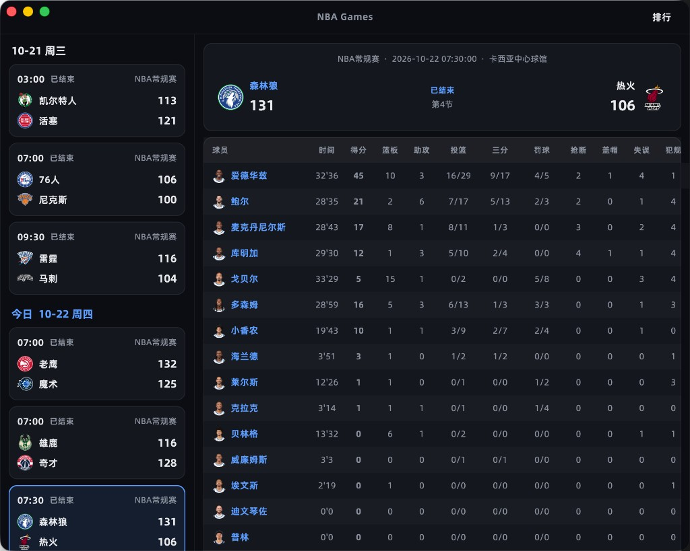
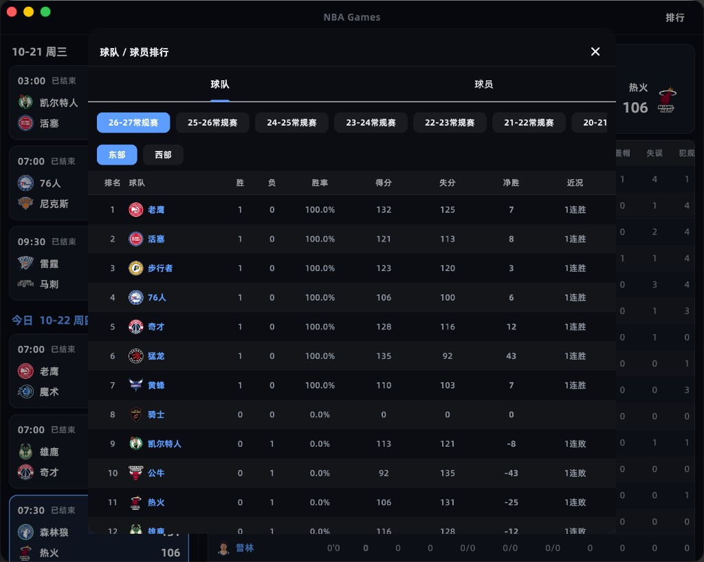
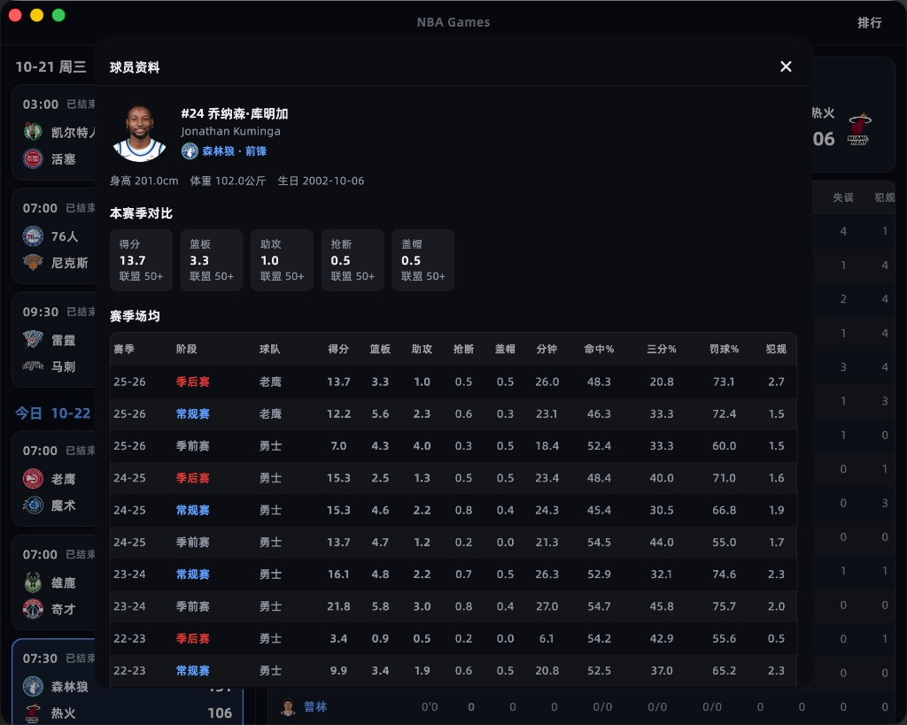

# NBA Games

跨平台 NBA 赛程与数据浏览应用，基于 Flutter 构建，数据来自腾讯体育公开接口。

支持 **macOS / Windows / Linux / iOS / Android / Web**，桌面端与手机端自适应同一套界面逻辑。

## 界面预览

| 赛程与比赛详情 | 球队 / 球员排行 | 球员资料 |
| --- | --- | --- |
|  |  |  |

## 功能

- **赛程**：按日期分组展示近期比赛，默认定位到今日；进行中场次可自动刷新（今日末场开赛约 2.5 小时后自动停止，并保留滚动位置）
- **比赛详情**：比分头图、分节比分、球队技术统计、球员数据表
- **排行榜**：球队积分榜（东 / 西部，含得分、失分、净胜等）与球员数据排行（得分 / 篮板 / 助攻 / 抢断 / 盖帽），支持赛季切换
- **资料弹窗**：点击球队 / 球员可查看赛季场均等信息
- **主题**：浅色 / 深色模式切换

### 布局差异

| 端 | 布局 |
| --- | --- |
| 宽屏（≥800） | 左侧赛程 + 右侧详情；排行以弹窗打开 |
| 手机 | 底部 Tab：赛程 / 排行；点进比赛进入独立详情页 |

## 技术栈

- Flutter 3.x（建议使用 [FVM](https://fvm.app/) 管理 SDK）
- [dio](https://pub.dev/packages/dio) 网络请求
- [flutter_screenutil](https://pub.dev/packages/flutter_screenutil) 屏幕适配
- [window_manager](https://pub.dev/packages/window_manager) 桌面窗口（无边框标题栏等）
- 字体：阿里巴巴普惠体

数据源：腾讯体育 Match Web / App Sports API（赛程、详情、排行、球队与球员资料）。

## 快速开始

```bash
# 若使用 FVM
fvm flutter pub get
fvm flutter run -d macos   # 或其他设备：ios / android / chrome / windows / linux

# 或使用本机 Flutter
flutter pub get
flutter run
```

生成各平台启动图标（修改 `assets/images/icon.png` 后）：

```bash
fvm flutter pub run flutter_launcher_icons
```

## 目录结构

```
lib/
  main.dart                 # 入口、主题与桌面窗口初始化
  pages/
    home_page.dart          # 赛程主页（桌面分栏 / 手机 Tab）
    match_detail_page.dart  # 比赛详情
  request/
    tencent_nba_api.dart    # 腾讯体育 API
  models/
    nba_game_model.dart     # 数据模型
  widgets/
    rank_dialog.dart        # 排行榜
    profile_dialogs.dart    # 球队 / 球员资料
    theme_settings_button.dart
  theme/                    # 主题与主题控制器
assets/
  fonts/                    # 普惠体
  images/icon.png           # 应用图标源图
docs/screenshots/           # README 截图
```

## 说明

本项目仅供学习与个人浏览使用，赛程与统计数据版权归腾讯体育及相关权利方所有。接口如有变更，可能需要相应调整解析逻辑。
